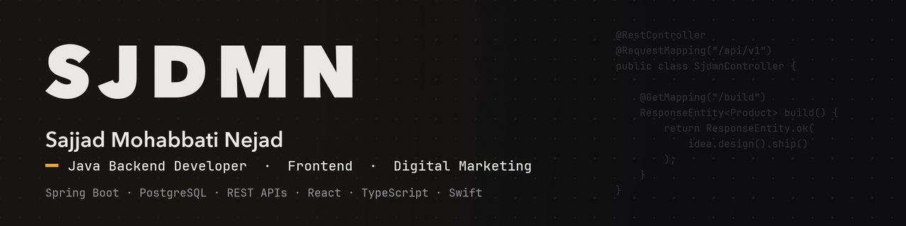
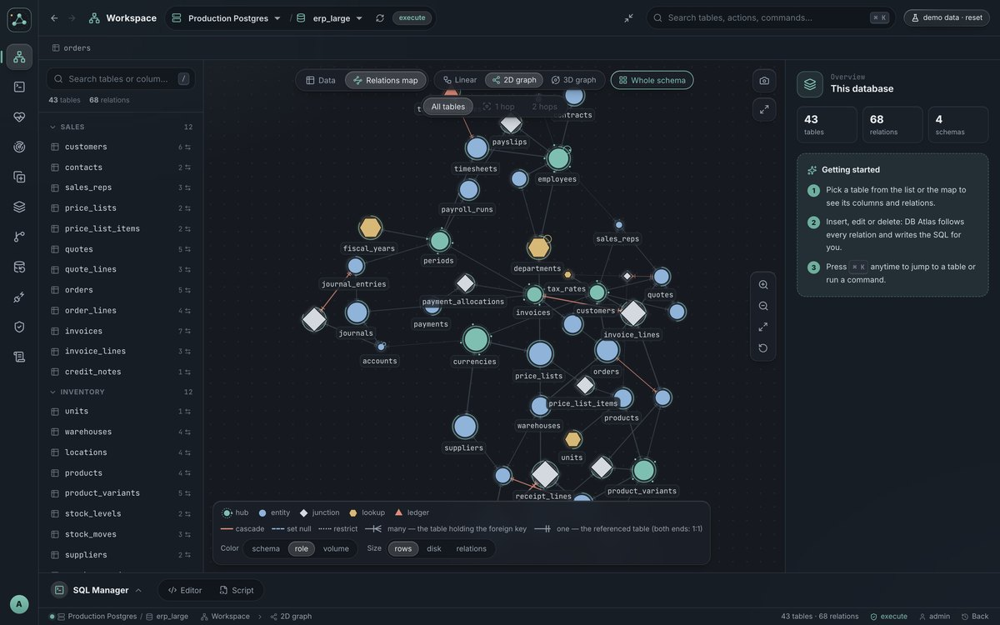
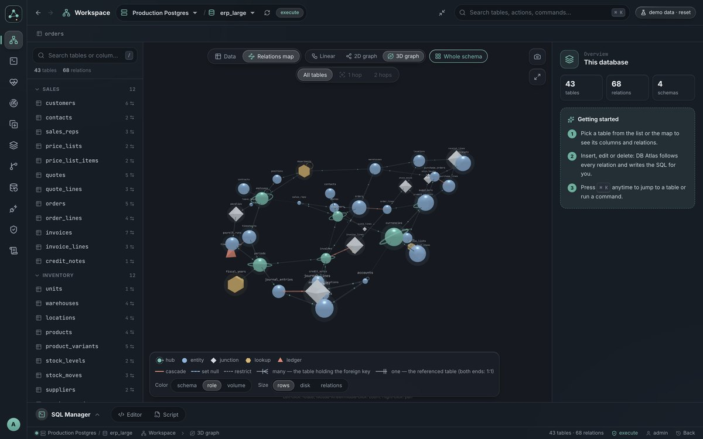
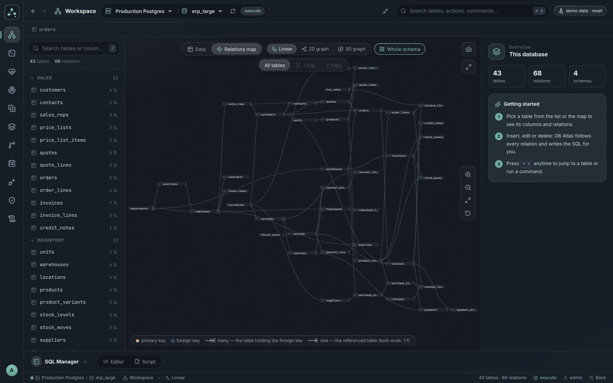
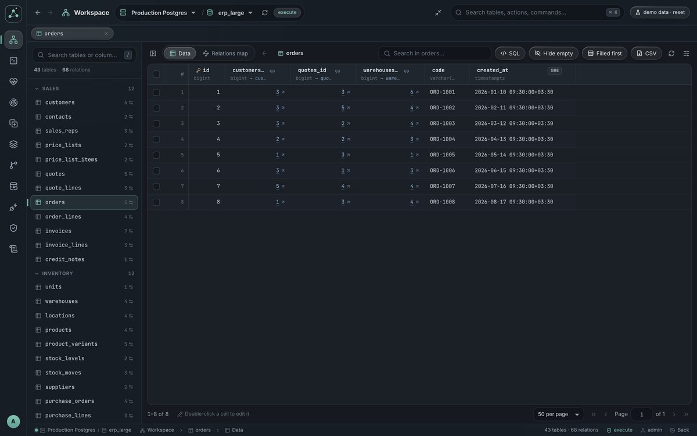
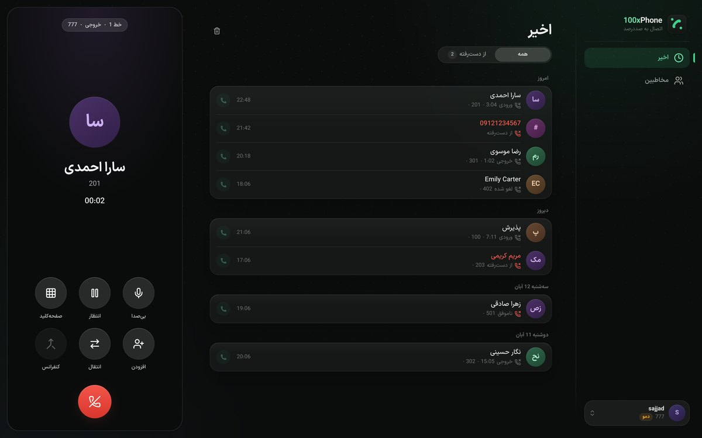
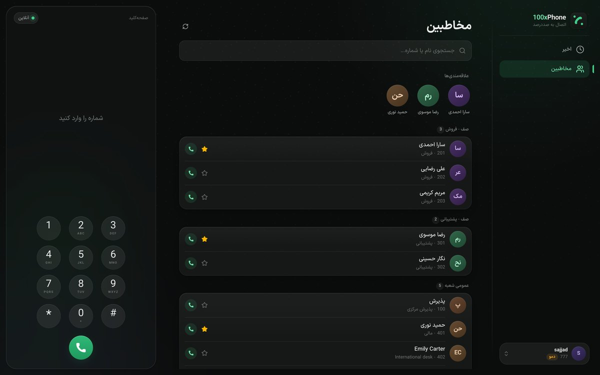
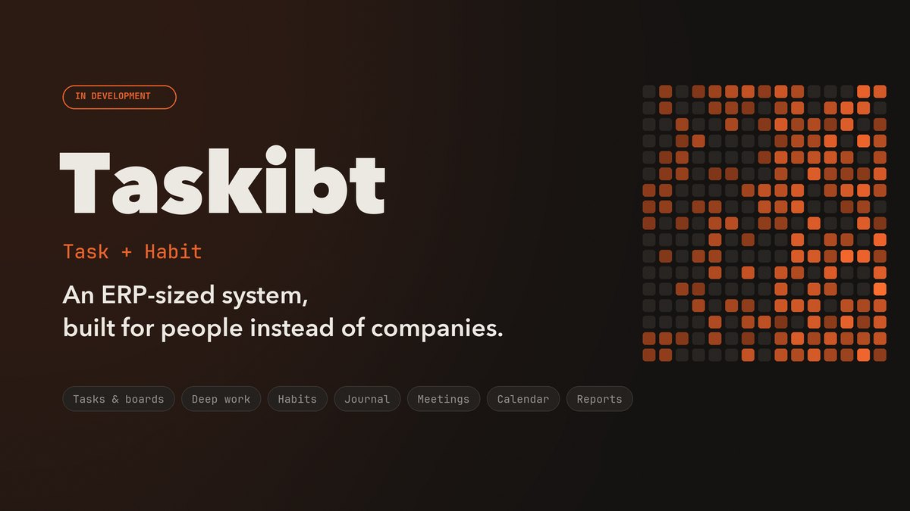
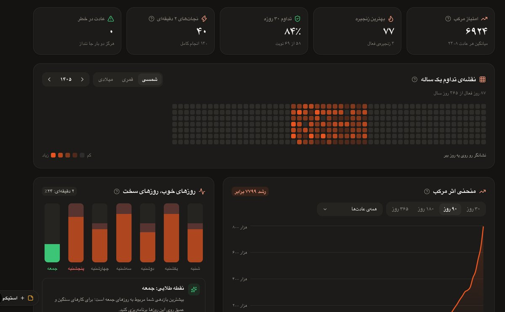

  

  
  
  

## Hi, I'm Sajjad 👋

I'm a **Java backend developer** from Isfahan, Iran. I build Spring Boot services on PostgreSQL, and I'm comfortable on the frontend too, with React and TypeScript. I like the hard parts of a system: data that has to stay consistent, integrations with things that were never meant to talk to each other, and screens people use all day.

- 💼 Backend developer at **Tafavot Co.** since 2024, working on a large ERP for the food industry
- 📞 Wrote the ERP's **telephony engine** for Asterisk / FreePBX and its WebRTC softphone
- 🎓 Computer engineering student at **Islamic Azad University, Isfahan (Khorasgan)**
- 🎨 Started working at 15 as a web designer, then ran branding and digital marketing for a food group
- 🛠️ In my own time I build tools I need myself, two of them open source (below)

## 🚀 Open source

<table>
  <tr>
    <td valign="top">
      
      <h3><a href="https://github.com/SajjadMohabati/clipbar">ClipBar</a></h3>
      A clipboard manager for <b>macOS and Linux</b> that never loses what you type. <b>Drafts</b> recovers text you typed and lost, plus locked items, automatic screenshots, OCR search and instant paste. Liquid Glass design for macOS Tahoe.
        
      <code>Swift</code> <code>SwiftUI</code> <code>Python</code> <code>GTK4</code>
        
      
      
    </td>
  </tr>
  <tr>
    <td valign="top">
      
      <h3><a href="https://github.com/SajjadMohabati/DevNet">DevNet</a></h3>
      <b>Split tunneling and VPN bypass</b> for macOS and Linux: route networks, domains and whole countries around
      any VPN from the menu bar or tray. DNS switcher (Shecan, 403, Cloudflare), a Cloudflare speed test and a dev-server manager.
        
      <code>SwiftUI</code> <code>Python</code> <code>GTK4</code> <code>libadwaita</code>
        
      
      
    </td>
  </tr>
</table>

## 🔒 Closed-source work

These are private products, so the code isn't public. A demo is available on request.

### 🗺️ DB Atlas: a database workspace for PostgreSQL

A self-hosted, multi-user workspace for PostgreSQL that I designed and built end to end: backend, frontend and UX.

- **Safe changes in deeply related data.** Deleting rows or dropping a table in a schema with hundreds of foreign keys usually breaks constraints or cascades silently. DB Atlas plans the whole change, shows every affected table with row counts, and runs a reviewed, ordered script in one transaction.
- **Understanding an unknown schema** as an ER diagram, a 2D graph and a 3D graph.
- **Browsing data like a map:** linked values are clickable and every jump is kept in a trail.
- **Daily operations:** health score, live traffic, lock trees, vacuum and wraparound, row-level change history with undo, scheduled backups and one-click environment copies.
- **Team access** with per-database permissions, an audit log and encrypted credentials.

<table>
  <tr>
    <td width="50%"></td>
    <td width="50%"></td>
  </tr>
  <tr>
    <td width="50%"></td>
    <td width="50%"></td>
  </tr>
</table>

<code>Java 21</code> <code>Spring Boot</code> <code>Spring Security</code> <code>Hibernate</code> <code>Flyway</code> <code>PostgreSQL 10–18</code> <code>React 19</code> <code>D3</code> <code>Three.js</code> <code>Docker</code>

### 📞 VoIP engine and 100xPhone softphone

A telephony engine (a Spring Boot library) I designed and wrote for a large food-industry ERP. It connects the ERP to Asterisk / FreePBX and turns it into a full call-center and office phone system, managed from the ERP.

- Extensions, **queues** with static and dynamic agents, ring groups, IVR menus and inbound routes
- **Precise queue monitoring:** a live wallboard of every call, its queue position, agents and waiting times
- **A dedicated dialplan:** every inbound call asks the ERP where to go, so routing follows business rules
- Complete call records and recordings, multi-branch PBX sharing, and a single pinned SSH connection
- **100xPhone**, a WebRTC softphone (web, PWA, extension and mobile) that signs in with the ERP account

A standalone version is in development; the engine can already run a complete call center today.

<table>
  <tr>
    <td width="50%"></td>
    <td width="50%"></td>
  </tr>
</table>

<code>Java 21</code> <code>Spring Boot</code> <code>Asterisk AMI</code> <code>FreePBX</code> <code>WebRTC</code> <code>JsSIP</code> <code>TURN</code> <code>React</code> <code>React Native</code>

### ✅ Taskibt (Task + Habit) · in development

We spend a lot on systems that run our businesses, and almost nothing on the one that runs our lives. Taskibt is an
**ERP-sized system for people, not companies**: tasks and boards, deep work, habits, a journal, meetings, a three-calendar view and reports, drawing on *Atomic Habits*, *Mini Habits*, *Deep Work* and *The Compound Effect*. Offline-first. The idea that ties it all together isn't public yet.

<table>
  <tr>
    <td width="50%"></td>
    <td width="50%"></td>
  </tr>
</table>

<code>Next.js</code> <code>React</code> <code>TypeScript</code> <code>Tailwind CSS</code> <code>IndexedDB</code>

## 🧰 Tech stack

**Backend** 
        

**Frontend and apps** 
       

## 🧭 Path so far

| When | What |
|---|---|
| 2024 – now | **Java backend developer**, Tafavot Co. · Spring Boot, PostgreSQL, ERP integrations, telephony |
| 2023 – now | **Computer engineering**, Islamic Azad University, Isfahan (Khorasgan) |
| 2019 – 2024 | **Web designer, then branding and digital marketing manager**, Haj Behzad Food Group · WordPress, social media, advertising |

Isfahan, Iran · <a href="https://www.linkedin.com/in/SajjadMohabati">linkedin.com/in/SajjadMohabati</a>

